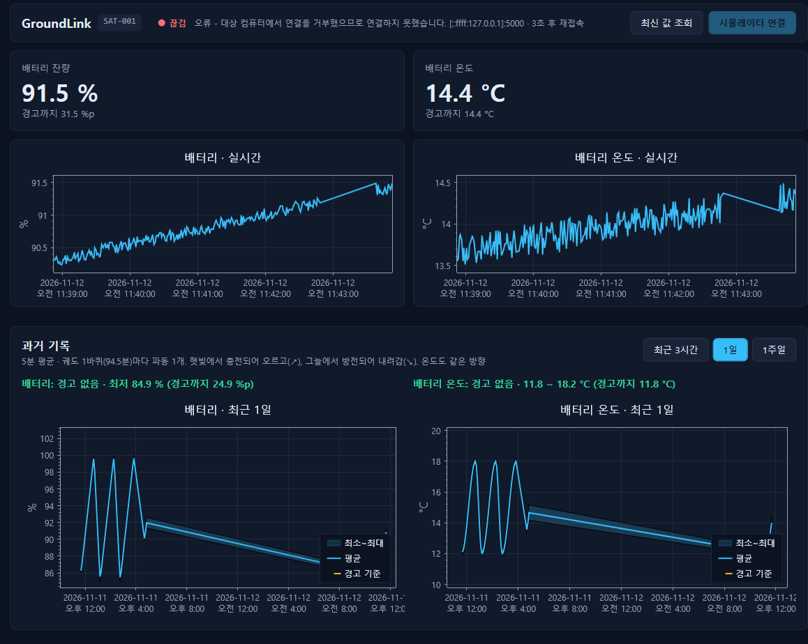
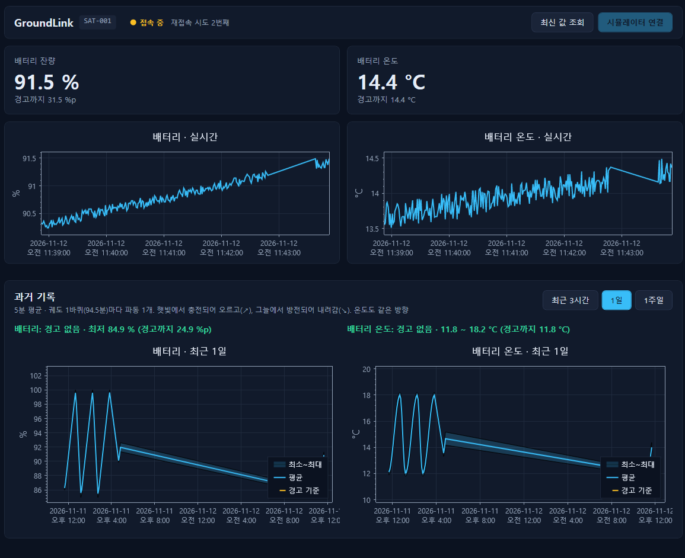
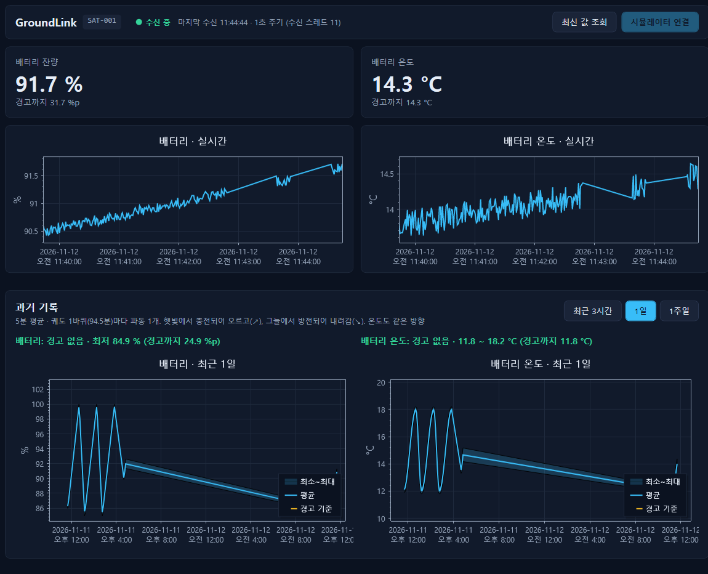

# GroundLink v2 테스트 기록

수동 테스트의 절차와 결과를 기록한다. 결과는 직접 실행해서 확인한 것만 적고, 확인하지 않은 것은 "미실시"로 둔다.

- 결과 표기: 통과 / 실패 / 의도된 실패(문제를 일부러 재현한 실험) / 미실시
- 요구사항 ID(F-, N-, U-)는 `requirements.md` 기준

## 요약

| ID | 단계 | 테스트 | 요구사항 | 결과 | 날짜 |
| --- | --- | --- | --- | --- | --- |
| T-02-1 | 2 | DB 최신 값 1줄 표시 | F-01 | 통과 | 2026-11-10 |
| T-03-1 | 3 | 1주일 요약 차트 표시 | F-03, F-04 | 통과 | 2026-11-10 |
| T-03-2 | 3 | 기간 버튼 1시간/1일/1주일 전환 | F-03 | 미실시 | |
| T-04-1 | 4 | 시뮬레이터 1초 주기 JSON 전송 | F-06 | 통과 | 2026-11-10 |
| T-04-2 | 4 | 클라이언트 끊김 후 재대기·재접속 | F-06 | 통과 | 2026-11-10 |
| T-04-3 | 4 | 궤도 모델: 햇빛 구간 값 범위 | F-06 | 통과 | 2026-11-10 |
| T-04-4 | 4 | 궤도 모델: 그늘 전환 | F-06 | 미실시 | |
| T-05-1 | 5 | UI 스레드에서 수신 → 창 멈춤 | N-03 | 의도된 실패 | 2026-11-10 |
| T-05-2 | 5 | 별도 스레드 수신 + Dispatcher 갱신 | F-07, N-03 | 통과 (일부) | 2026-11-10 |
| T-05-3 | 5 | 수신 중 시뮬레이터 종료 → 끊김 표시 | F-07 | 통과 | 2026-11-12 |
| T-05-4 | 5 | 시뮬레이터 꺼진 상태에서 연결 → 오류 표시, 앱 유지 | F-07 | 미실시 | |
| T-05-5 | 5 | (선택) 수신 스레드에서 화면 직접 변경 → 예외 | F-07 | 미실시 | |
| T-05-6 | 5 | 수신 JSON → 현재 값 표시 (정상 범위 검은색) | F-01, F-07 | 통과 | 2026-11-10 |
| T-05-7 | 5 | 경고 기준 벗어나면 빨간색 + "경고" | F-02 | 미실시 | |
| T-06-1 | 6 | 수신 데이터 DB 저장 (Source = 2, 10건 묶음 + 끊길 때 남은 것) | F-09, N-04 | 통과 | 2026-11-11 |
| T-06-2 | 6 | 같은 위성·시각 중복 저장 방지 (고유 인덱스) | F-09 | 통과 (결과 화면 미기록) | 2026-11-11 |
| T-06-3 | 6 | 연결 상태 표시 (접속 중 / 수신 중 / 끊김 색) | F-10, U-04 | 통과 | 2026-11-12 |
| T-06-4 | 6 | 끊기면 3초마다 자동 재접속, 시뮬레이터 다시 켜면 수신 재개 | F-10, N-05 | 통과 | 2026-11-12 |
| T-07-1 | 7 | 성능 측정: 1 / 10 / 100건/초 × 화면 갱신 묶기 끔/켬 | N-02, N-03 | 미실시 | |
| T-07-2 | 7 | 단위 테스트 (xUnit) 전체 통과 | N-07 | 미실시 | |
| T-07-3 | 7 | 1주일 차트: 궤도 1바퀴 단위 선 2개 | F-04 | 미실시 | |
| T-07-4 | 7 | 과거 기록 차트: 데이터 없는 시간에서 선 끊김 | F-04 | 미실시 | |
| T-07-5 | 8 | 설정 파일 읽기, 없으면 이유 표시 후 종료 | - | 미실시 | |

## 발견된 문제

| 날짜 | 문제 | 상태 |
| --- | --- | --- |
| 2026-11-10 | 과거 기록 차트의 제목·범례·x축(오전/오후) 한글이 □로 표시됨 | 해결 |
| 2026-11-11 | 1주일 차트(30분 평균)가 위아래로만 왔다갔다해서 읽을 수 없음. 원인: 1주일에 궤도 약 107바퀴 → 파동 107개가 화면 폭에 들어감 | 해결: 1주일은 궤도 1바퀴 단위 최고·최저 선 2개로 변경 |
| 2026-11-12 | 과거 기록 차트가 데이터 없는 시간(11-11 17시경 ~ 11-12 오전)을 직선으로 이어 그려 값이 있는 것처럼 보임 (images/T-06-4_reconnected.png 아래 차트) | 수정함, 앱 확인 전: 빈 시간에서 선을 끊음 |
| 2026-11-12 | 실시간 차트도 끊긴 동안을 직선으로 이음 (images/T-06-4_reconnected.png 위 차트) | 미해결: 끊김이 몇 초~몇 분이라 영향 작음 |

**한글 □ 표시 해결 과정**

| 시도 | 결과 | 비고 |
| --- | --- | --- |
| `Font.Set("Malgun Gothic")`을 차트 그리기 전에 호출 | 실패 | |
| 같은 줄을 날짜 축 생성 후로 이동 + `Legend.FontName` | 실패 | |
| `Font.Automatic()` | 실패 | 눈금 글자는 그릴 때 만들어져서 자동 선택 대상이 아님 (소스 확인) |
| `Fonts.AddFontFile("KoreanFont", @"C:\Windows\Fonts\malgun.ttf")` 등록 후 `Font.Set("KoreanFont")` + `Legend.FontName` | **성공** | |

원인: ScottPlot은 글꼴을 이름으로 못 찾으면 에러 없이 기본 글꼴(한글 없음)로 대체한다 (`Fonts.GetTypeface`). "Malgun Gothic" 이름 검색이 실패한 것으로 판단. 글꼴 파일을 직접 등록해 이름 검색을 우회함. 환경: ScottPlot.WPF 5.1.59, Windows 10 20H2.

## 공통 실행 방법

- 시뮬레이터: 솔루션 탐색기 → `GroundLink.Simulator` 우클릭 → 디버그 → 새 인스턴스 시작
- WPF: 솔루션 탐색기 → `GroundLink` 우클릭 → 디버그 → 새 인스턴스 시작
- PowerShell 클라이언트 (시뮬레이터 단독 확인용)

```powershell
$c = New-Object System.Net.Sockets.TcpClient('127.0.0.1', 5000)
$r = New-Object System.IO.StreamReader($c.GetStream())
while ($true) { $r.ReadLine() }
```

- 시뮬레이터는 한 번에 클라이언트 1개만 처리한다. WPF 테스트 전에는 PowerShell 접속을 닫는다.
- 종료: VS에서 `Shift+F5`

## 상세

### T-02-1 DB 최신 값 1줄 표시

- 절차: WPF 실행 → "최신 값 조회" 클릭
- 예상: 시각, 배터리, 온도가 표시되고 SSMS `99_checks.sql`의 "최신 1줄" 결과와 같음
- 결과: 통과 (2026-11-10, 시각 2026-11-09 14:08:56, 배터리 59.9 %, 온도 2.4 °C, 이전 더미 데이터 기준)

### T-03-1 1주일 요약 차트 표시

- 절차: WPF 실행
- 예상: 30분 단위 요약 차트가 표시됨
- 결과: 통과 (2026-11-10, 297개 구간). 이전 더미 데이터(90분 주기)에서 값 3개만 반복되는 현상 발견 → 원인: 데이터 주기와 요약 단위가 맞물림(에일리어싱). 더미 데이터를 궤도 모델로 교체함

### T-03-2 기간 버튼 전환

- 절차: WPF 실행 → 1시간, 1일, 1주일 버튼을 차례로 클릭
- 예상: 제목이 기간에 맞게 바뀌고, 구간 수가 약 60 / 288 / 337 (최근 데이터가 있을 때)
- 결과: 미실시

### T-04-1 시뮬레이터 1초 주기 JSON 전송

- 절차: 시뮬레이터 실행 → PowerShell 클라이언트 접속
- 예상: 1초마다 `{"satelliteId":"SAT-001","recordedAt":...,"battery":...,"temperature":...}` 한 줄씩 수신
- 결과: 통과 (2026-11-10)

### T-04-2 끊김 후 재대기·재접속

- 절차: PowerShell 창 닫기 → 시뮬레이터 콘솔 확인 → PowerShell 다시 접속
- 예상: "연결 끊김" → "접속 대기" 출력, 재접속 시 다시 수신
- 결과: 통과 (2026-11-10)

### T-04-3 궤도 모델: 햇빛 구간

- 절차: 시뮬레이터 실행 후 콘솔 확인
- 예상: `[햇빛 N초]` 표시, 배터리 85~100, 온도 12~18
- 결과: 통과 (2026-11-10)

### T-04-4 궤도 모델: 그늘 전환

- 절차: 아래 SQL로 현재 궤도 위치 확인 → 3,912초가 되는 시각에 시뮬레이터 콘솔 확인

```sql
SELECT DATEDIFF_BIG(SECOND, '2026-01-01T00:00:00', SYSDATETIME()) % 5669 AS 지금_궤도_초;
```

- 예상: `[햇빛 3911초]` → `[그늘 3912초]`, 이후 배터리·온도 하강. SQL 결과와 시뮬레이터 초가 1~2초 이내
- 결과: 미실시

### T-05-1 UI 스레드에서 수신 (의도된 실패)

- 목적: UI 스레드에서 블로킹하면 화면이 멈추는 것을 재현 (7단계 분리 전후 비교 자료)
- 절차: 시뮬레이터 실행 → WPF 실행 → "시뮬레이터 연결" 클릭
- 예상: 시뮬레이터는 계속 전송, WPF 화면은 갱신 안 됨, 버튼·창 이동 불가, "응답 없음"
- 결과: 의도된 실패 확인 (2026-11-10, "응답 없음" 표시)

### T-05-2 별도 스레드 수신 + Dispatcher

- 절차: 시뮬레이터 실행 → WPF 실행 → "시뮬레이터 연결" 클릭 → 연결 중 기간 버튼 클릭, 창 이동
- 예상: "실시간" 글자가 1초마다 갱신, 스레드 번호가 UI(1)와 수신(다른 번호)으로 다름, 버튼·창 이동 정상, 연결 버튼 비활성
- 결과: 통과 (일부, 2026-11-10). 시뮬레이터 연동과 수신 값 화면 갱신 확인. 스레드 번호, 연결 중 버튼·창 이동은 미기록

### T-05-3 수신 중 시뮬레이터 종료

- 절차: T-05-2 상태에서 시뮬레이터 콘솔 닫기
- 예상 (6단계 자동 재접속 이후 기준): 빨간 "끊김" + 사유 + "3초 후 재접속" 표시, 앱 유지. 연결 버튼은 비활성 유지 (재접속은 자동)
- 결과: 통과 (2026-11-12). "끊김 · 오류 - 대상 컴퓨터에서 연결을 거부했으므로 연결하지 못했습니다. [::ffff:127.0.0.1]:5000 · 3초 후 재접속" 표시, 앱 유지



### T-05-4 시뮬레이터 없이 연결

- 절차: 시뮬레이터 끈 상태에서 WPF "시뮬레이터 연결" 클릭
- 예상 (6단계 이후 기준): "끊김 · 오류 - ..." 와 "접속 중 · 재접속 시도 N번째"가 3초마다 번갈아 표시, 앱 종료되지 않음
- 결과: 미실시. 같은 처리 경로(접속 거부 → 재시도)는 T-05-3, T-06-4에서 확인됨

### T-05-5 (선택) 수신 스레드에서 화면 직접 변경

- 절차: `ReceiveLoop`의 `Dispatcher.InvokeAsync(...)`를 잠시 `LiveText.Text = ...` 직접 대입으로 바꾸고 실행 → 확인 후 원래대로 복구
- 예상: `InvalidOperationException` ("다른 스레드가 이 개체를 소유" 내용)이 catch되어 "오류" 표시
- 결과: 미실시

### T-05-6 수신 JSON → 현재 값 표시

- 절차: 시뮬레이터 실행 → WPF 실행 → "시뮬레이터 연결"
- 예상: 배터리·배터리 온도가 큰 글씨로 1초마다 갱신, 정상 범위라 검은색
- 결과: 통과 (2026-11-10, 수신 스레드 11, 배터리 94.6 %, 배터리 온도 16.1 °C, 검은색)

### T-05-7 경고 표시

- 절차: 시뮬레이터를 `--warn` 옵션으로 실행 (배터리 45~60 %) → WPF "시뮬레이터 연결"
- 예상: 배터리 숫자와 아래 글자가 빨간색, "경고: 60 % 미만"
- 결과: 미실시

### T-06-1 수신 데이터 DB 저장

- 절차: 시뮬레이터 연결 → 12초쯤 수신 → 시뮬레이터 종료 → SSMS에서 `SELECT COUNT(*) FROM dbo.Telemetry WHERE Source = 2;`
- 예상: 10건 묶음 저장 + 끊길 때 남은 건 저장 → 받은 건수와 같음
- 결과: 통과 (2026-11-11, 12줄 = 10건 묶음 + 끊길 때 2건)

### T-06-2 중복 저장 방지

- 절차: `DB/04_unique_time.sql` 실행
- 예상: 1번(중복 확인) 0줄, 2번(고유 인덱스 생성) 오류 없음
- 결과: 통과 (2026-11-11, 사용자 보고. 결과 화면 미기록)

### T-06-3 연결 상태 표시

- 절차: T-06-4 진행 중 상단 바 확인
- 예상: 접속 중 = 주황, 수신 중 = 초록, 끊김 = 빨강. 옆에 상세 글자 (재접속 횟수 / 마지막 수신 시각 / 끊긴 이유)
- 결과: 통과 (2026-11-12). 세 상태 모두 해당 색과 상세 글자 표시 (아래 T-06-4 화면 3장)

### T-06-4 자동 재접속

- 절차: 시뮬레이터 연결 → 시뮬레이터 콘솔 닫기 → 몇 초 뒤 시뮬레이터 다시 실행 (앱 버튼은 누르지 않음)
- 예상: 끊김 → 3초 후 "접속 중 · 재접속 시도 N번째" 반복 → 시뮬레이터가 켜지면 버튼 없이 "수신 중"으로 복귀
- 결과: 통과 (2026-11-12). "재접속 시도 2번째" 표시 후 "수신 중 · 마지막 수신 11:44:44 · 수신 스레드 11"로 복귀. 실시간 차트에 끊긴 구간이 보임





### T-07-1 성능 측정

- 준비: `DB/05_time_milliseconds.sql` 실행 (1초에 여러 건 저장되게)
- 절차: 시뮬레이터를 `--hz 1`, `--hz 10`, `--hz 100`으로 각각 실행 → WPF 연결 → 30초 뒤 상단 성능 줄 기록. "화면 갱신 묶기"를 끄고 같은 순서로 반복. 각 조건에서 창 이동·버튼 반응도 확인
- 기록할 값: 수신 건/초, 차트 그리기 회/초·평균 ms·최대 ms, 수신→화면 평균·최대 ms, DB 저장 1회 평균 ms

| 조건 | 수신 건/초 | 그리기 회/초 | 그리기 평균 ms (최대) | 수신→화면 평균 ms (최대) | DB 저장 ms | 창 반응 |
| --- | --- | --- | --- | --- | --- | --- |
| 1건/초, 묶기 끔 | | | | | | |
| 1건/초, 묶기 켬 | | | | | | |
| 10건/초, 묶기 끔 | | | | | | |
| 10건/초, 묶기 켬 | | | | | | |
| 100건/초, 묶기 끔 | | | | | | |
| 100건/초, 묶기 켬 | | | | | | |

- 결과: 미실시
- 참고 (개발 PC 밖에서 확인한 것): ViewModel만 따로 돌려 100건/초 시뮬레이터에 3초 연결 → 묶기 켬: 화면 알림 30번에 점 301개 전부 반영, 묶기 끔: 화면 알림 301번 (2026-11-12, 차트·DB 없이)

### T-07-2 단위 테스트

- 절차: Visual Studio 테스트 탐색기 → 모두 실행 (또는 `dotnet test GroundLink.Tests`)
- 예상: 경고 판정 12케이스, ViewModel 5개, 성능 측정 2개, 총 19개 통과
- 결과: 미실시

### T-07-3 1주일 차트

- 준비: `02_seed_week.sql`을 다시 실행해 최근 1주일 데이터를 채움 (주의: 소켓으로 받은 Source = 2 데이터도 지워짐)
- 절차: WPF 실행 → "1주일"
- 예상: 위 선(바퀴별 최고) 약 100 %, 아래 선(바퀴별 최저) 약 85 %에서 평평. 결론 줄에 "약 106바퀴 경고 없음 · 최저 변화 0.0 %p 안팎"
- 결과: 미실시

### T-07-4 빈 시간에서 선 끊김

- 절차: 데이터가 비어 있는 시간이 있는 상태에서 "1일"
- 예상: 빈 시간은 선 없이 비어 있음 (전에는 사선으로 이어짐: images/T-06-4_reconnected.png 아래 차트)
- 결과: 미실시

### T-07-5 설정 파일

- 절차: 빌드 출력 폴더(`bin/Debug/net8.0-windows`)의 `appsettings.json` 이름을 잠시 바꾸고 실행 → 원래대로 복구
- 예상: "설정 오류" 창에 "appsettings.json이 실행 파일 옆에 없습니다" 표시 후 종료
- 결과: 미실시

