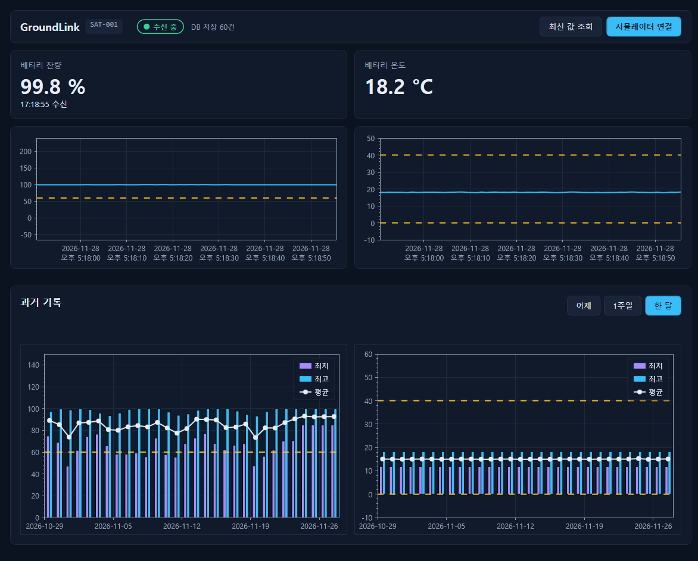
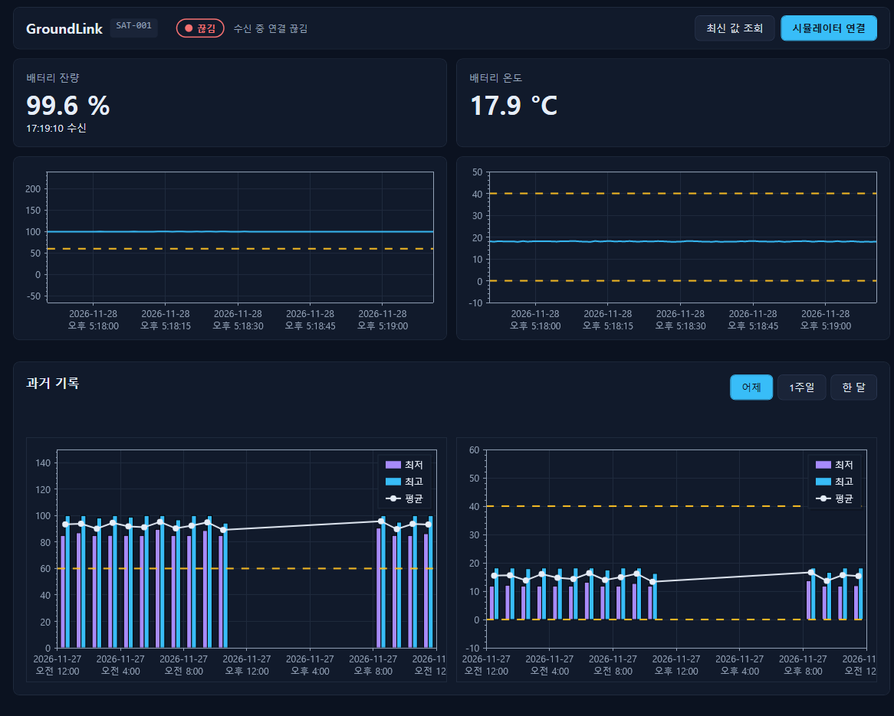
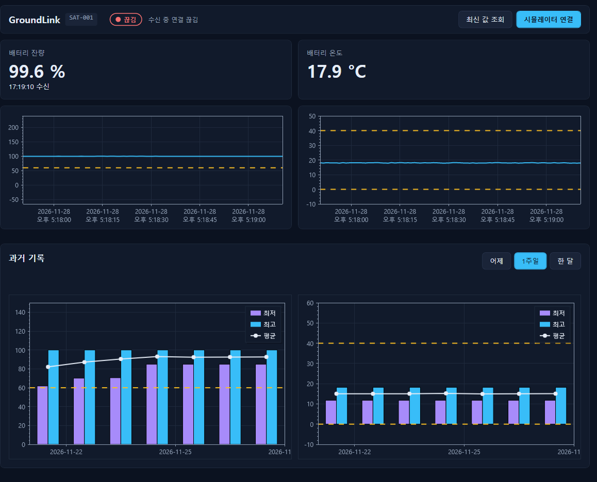

# GroundLink

위성 시뮬레이터가 1초마다 보내는 텔레메트리(배터리 잔량, 배터리 온도)를 TCP로 받아
**실시간 차트로 보여주고, DB에 저장하고, 지난 기록(어제·1주일·한 달)을 조회**하는 WPF 지상 수신·관제 앱



---

## 주요 기능

| 기능 | 내용 |
| --- | --- |
| 실시간 수신 | 시뮬레이터(위성 역할)에서 1초마다 JSON 한 줄 수신, 수신 전용 스레드 |
| 실시간 차트 | 배터리·온도 선 그래프 + 경고 기준선 |
| DB 저장 | 10건씩 묶어 저장, 연결이 끊기거나 앱을 닫을 때 남은 데이터 저장 |
| 과거 기록 | 어제(원본, 1시간 단위) / 1주일·한 달(하루 요약 테이블, 하루 단위) 최저·최고·평균 |
| 연결 상태 | 연결 중 → 수신 중 / 끊김 / 연결 실패 (응답 없으면 3초 뒤 실패 표시) |

| 끊김 + 어제 기록                           | 끊김 + 1주일 기록                           |
| ------------------------------------ | ------------------------------------- |
|  |  |

---

## 사용 기술

- C# / .NET 9, WPF
- MVVM: CommunityToolkit.Mvvm 8.4.2
- 차트: ScottPlot.WPF 5.1.59
- DB: Microsoft SQL Server Express, Microsoft.Data.SqlClient 7.1.1
- 통신: TCP 소켓 (JSON 한 줄 단위)
- 테스트: xUnit

## 구조

```
GroundLink/                 WPF 앱
├─ ViewModels/              MainViewModel (화면 상태, 명령)
├─ Services/                TelemetryReceiver (수신 스레드), TelemetrySaver (10건 묶음 저장)
├─ Network/                 TelemetryClient (TCP 연결, 한 줄 수신)
├─ Data/                    TelemetryRepository (조회, 하루 요약)
├─ Charts/                  ChartDrawer (실시간·과거 차트)
├─ Models/                  Telemetry, SummaryPoint
└─ MainWindow.xaml          화면
GroundLink.Simulator/       위성 시뮬레이터 (콘솔, TCP 서버)
GroundLink.Tests/           xUnit 테스트 (요약·원본 비교, 조회 시간 측정 등)
```


**데이터 흐름**
```
시뮬레이터 ──TCP──▶ 수신 스레드 ──▶ UI 스레드: 숫자·실시간 차트
                         └──────▶ 10건씩 DB 저장 (Telemetry)
앱 시작 / 자정 후 ──▶ 지난 30일 하루 요약 (TelemetryDaily)
과거 기록 버튼 ──▶ 어제: 원본 1시간 묶음 / 1주일·한 달: 하루 요약 7·30줄
```

---

## 실행 방법

### 1. DB
- SQL Server Express 인스턴스 `localhost\SQLEXPRESS`, 데이터베이스 `MonitorDB`
- 원본 테이블 `Telemetry` 필요 [채우기: 생성 스크립트 위치]
- 하루 요약 테이블 `TelemetryDaily`는 앱이 처음 실행될 때 자동으로 만듦
- 연결 문자열: `GroundLink/MainWindow.xaml.cs`

### 2. 시뮬레이터
```powershell
dotnet run --project GroundLink.Simulator
```
- 기본: 이 PC(`127.0.0.1:5000`)에서 대기
- 다른 PC에서 받으려면 대기 주소 지정: 환경 변수 `GROUNDLINK_SIM_BIND=시뮬레이터PC_IP`

### 3. 앱
```powershell
dotnet run --project GroundLink
```
- **시뮬레이터 연결** 버튼 → 상단이 "수신 중"으로 바뀌면 정상
- 다른 PC의 시뮬레이터에 연결: 환경 변수 `GROUNDLINK_SIM_HOST=시뮬레이터PC_IP`

### 4. 테스트
```powershell
dotnet test
```

---

## 트러블슈팅 / 성능 개선

### 1. 시뮬레이터 송신 주기 오차 → 시각 정렬
- **문제**: 16시간 수신 후 예상보다 약 677건 적음, 가끔 바로 앞 줄과 2초 간격
- **원인**: `Thread.Sleep(1000)`은 최소 1초를 쉬고 작업 시간도 더해져 약 1,012 ms마다 송신 → 오차가 쌓임
- **해결**: 매초 윈도우 시계 .500을 목표로 잡고, 남은 시간(목표 − 현재)만큼 대기 후 송신
  - 윈도우 시스템 클록 해상도(약 15 ms) 때문에 깨어나는 시점이 흔들리므로, 초의 한가운데(.500)에 두어 초 단위가 바뀌지 않게 함

| 방식 (같은 PC 측정) | 측정 시간 | 송신 시점 | 겹침 / 건너뜀 | 건수 차이 |
| --- | --- | --- | --- | --- |
| Thread.Sleep(1000) | 16시간 | 계속 밀림 | 0 / 677 | 약 −677 |
| PeriodicTimer | 15.4시간 | .162 → .564 이동 | 115 / 114 | +1 |
| 시각 정렬 + Task.Delay | 14.5시간 | .507 고정 | 0 / 0 | 0 |
| 시각 정렬 + Thread.Sleep | 2.9시간 | .507 고정 | 0 / 0 | 0 |

- 동기·비동기 대기 결과가 같음 → 핵심은 대기 방식이 아니라 매번 남은 시간을 계산하는 것

### 2. 한 달 조회가 느림 → 하루 요약 테이블
- **문제**: 한 달 조회 때마다 원본 약 257만 줄을 집계
- **해결**: 날짜별 건수·합계·최저·최고를 `TelemetryDaily`에 미리 저장, 1주일·한 달은 요약 테이블에서 조회

| | 이전 | 이후 |
| --- | --- | --- |
| 한 달 조회 (테스트) | 1,564 ms | 0.5 ms |
| 한 달 조회 (앱) | 약 1.5초 | 1.7 ms |

- 원본과 요약 비교: 34일(10-25 ~ 11-27) 전부 건수·평균·최저·최고 차이 0

### 3. 응답 없는 주소로 연결하면 화면이 멈춤 → 비동기 연결 + 3초 제한
- **문제**: 다른 PC(맥) 연동 테스트 중, 상대가 응답하지 않으면 연결을 기다리는 동안 창이 멈춤
- **원인**: 연결(`TcpClient.Connect`)을 UI 스레드에서 동기로 실행
- **해결**: `ConnectAsync` + 3초 제한, 실패 이유는 상단 상태 바에 표시

### 4. 수신 중 UI 멈춤 → 수신 전용 스레드
- [채우기: 개발 일지 T-09 내용과 수치]

---

## 다음 과제
- 수신 예외 감지: 보내는 쪽이 멈출 때 생기는 공백(≥ 1,500 ms)·몰림(< 500 ms)·같은 시각 감지 (다른 PC 측정 사례 기반)
- 수신 없음 감시: 연결 중인데 일정 시간 데이터가 없으면 표시
