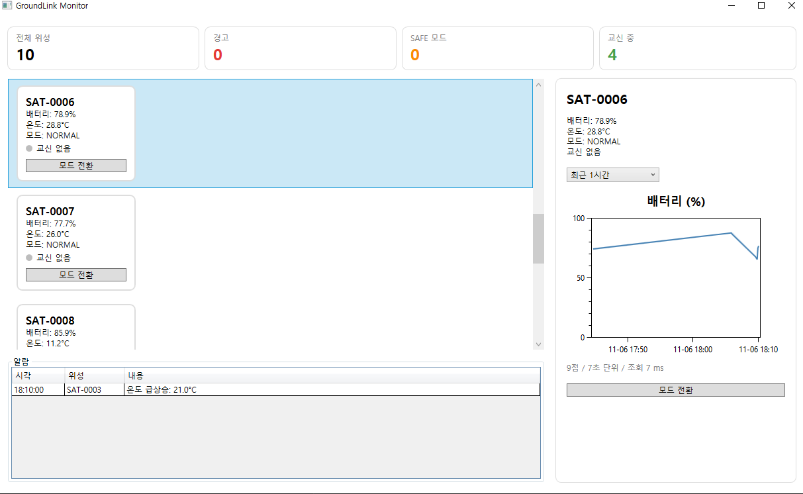
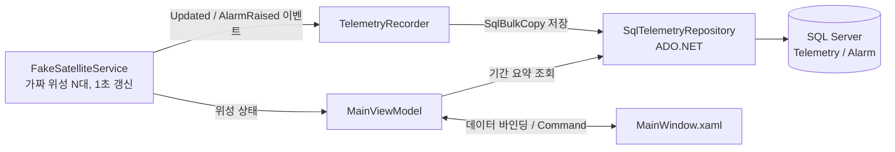
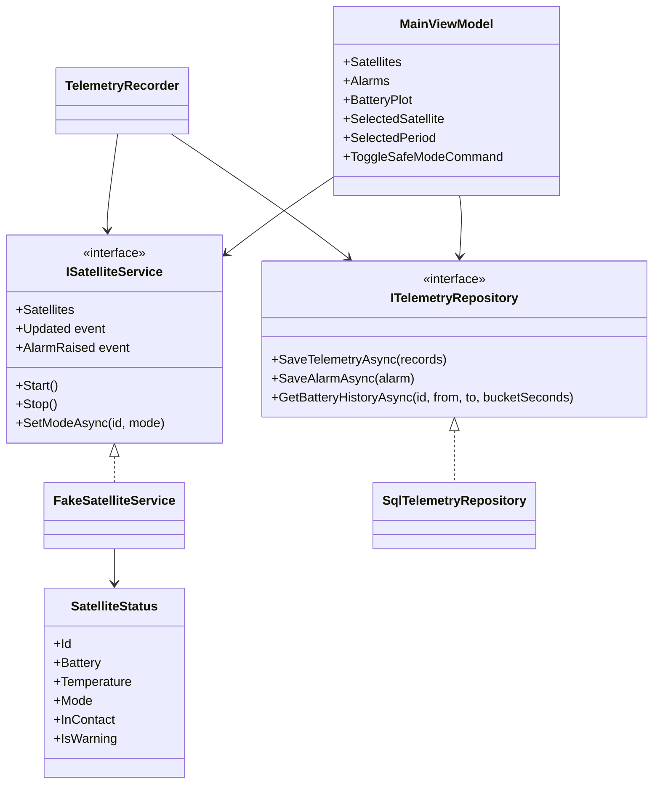
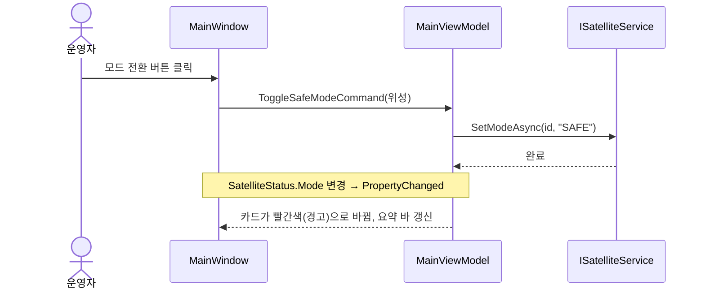

# GroundLink Monitor

가상 위성 지상국의 **WPF 관제 앱**입니다.
위성 상태를 실시간으로 감시하고, 위성에 모드 전환 명령을 보내고, 텔레메트리 이력을 MS-SQL에 저장해 기간별 차트로 보여줍니다.

> 백엔드(위성 시뮬레이터 → MQTT → NestJS 수집 서버 → PostgreSQL)는 [GroundLink](https://github.com/nile27/GroundLink) 저장소에 있습니다.
> 현재 이 앱은 가짜 위성 서비스로 동작하며, 백엔드 배포 후 서버 API로 교체할 수 있게 설계되어 있습니다.



## 주요 기능

- **실시간 감시:** 위성별 배터리·온도·운용 모드·교신 상태를 카드로 표시 (1초 갱신)
- **경고 표시:** SAFE 모드 또는 배터리 20% 미만 위성은 카드를 빨갛게 강조
- **상단 요약:** 전체 / 경고 / SAFE 모드 / 교신 중 위성 수
- **명령 송신:** 위성별 NORMAL ↔ SAFE 모드 전환
- **알람:** 배터리 부족 진입, 온도 급상승을 알람 표에 기록
- **이력 차트:** 최근 1분 / 1시간 / 24시간 배터리 추이 (DB에서 구간 요약 조회, 평균 선 + 최소~최대 띠)

## 기술 스택

| 구분 | 사용 기술 | 선택 이유 |
|---|---|---|
| UI | WPF (.NET 8) | 데스크톱 관제 화면 |
| 패턴 | MVVM (CommunityToolkit.Mvvm) | 화면과 로직 분리, ViewModel 단위 테스트 |
| DI | Microsoft.Extensions.DependencyInjection | 가짜 서비스 → 서버 연동 서비스 교체를 등록 한 줄로 |
| 차트 | OxyPlot | NuGet 사용량이 가장 많고 대량 데이터에 강함. 86,000점도 UI 지연 없이 렌더링하는 것을 직접 확인 |
| DB | SQL Server 2025 Express + ADO.NET (Microsoft.Data.SqlClient) | SQL을 직접 다루기 위해 ORM 없이 시작 |
| 테스트 | xUnit | Stub 서비스를 주입해 ViewModel 검증 |

## 구조



- **ViewModel은 DB를 모릅니다.** 저장은 `TelemetryRecorder`가 서비스 이벤트를 받아 처리합니다.
- **서비스와 저장소는 interface로 분리**되어 있어, 서버 연동 버전이나 EF Core 버전으로 교체해도 ViewModel과 화면은 바뀌지 않습니다.

### 주요 클래스



### 모드 전환 명령 흐름



## 성능 개선

모든 수치는 같은 PC에서 디버거 없이(Ctrl+F5) 실행해 `measure.log`로 측정했습니다.

### 1. 위성 목록 가상화

카드를 `WrapPanel`로 전부 만들던 방식에서 `VirtualizingStackPanel`(Recycling)로 바꿔, 화면에 보이는 카드만 만들고 재활용하도록 했습니다.

| 위성 수 | 가상화 | 만들어진 카드 | 화면 준비 | 메모리 |
|---|---|---|---|---|
| 1,000 | X | 1,000 | 3,300 ms | 203 MB |
| 3,000 | X | 3,000 | 7,150 ms | 353 MB |
| 10,000 | X | - | 응답 없음 | - |
| 10,000 | **O** | **4** | **439 ms** | **114 MB** |

### 2. DB 저장 방식

1초마다 들어오는 텔레메트리를 저장하는 세 가지 방식을 비교했습니다.

| 위성 수 | 한 건씩 INSERT | 트랜잭션으로 묶기 | SqlBulkCopy |
|---|---|---|---|
| 1,000 | 212 ms | 129 ms | **26 ms** |
| 5,000 | 1,300 ms (1초 초과, 저장 겹침) | - | **61 ms** |

- 트랜잭션: 커밋(로그 디스크 기록) 횟수를 1,000 → 1로 줄인 효과
- SqlBulkCopy: 커밋 횟수와 네트워크 왕복 횟수를 모두 줄인 효과 → **채택**

### 3. 저장 작업을 UI 스레드에서 분리

저장소의 모든 `await`에 `ConfigureAwait(false)`를 적용해, DataTable 생성 같은 작업이 UI 스레드에서 실행되지 않도록 했습니다.

| 위성 5,000대, SqlBulkCopy | UI 지연 (최대) |
|---|---|
| 적용 전 | 50~70 ms |
| 적용 후 | 25~48 ms |

### 4. 차트: DB 구간 요약 조회

위성 100대 × 24시간(864만 행) 데이터에서 위성 1대의 24시간 배터리 차트를 그릴 때, `DATE_BUCKET` + `GROUP BY`로 약 480구간의 최소·최대·평균만 가져옵니다.

| 방식 | 점 개수 | 조회 시간 |
|---|---|---|
| 원본 그대로 | 약 86,000 | 약 270 ms |
| 180초 구간 요약 | 480 | 약 150 ms |

평균만 쓰면 순간적인 급락이 묻히므로 최소~최대를 띠로 함께 표시합니다.

## 테스트

`StubSatelliteService`, `StubTelemetryRepository`를 주입해 화면 없이 ViewModel을 검증합니다.

- 배터리 20% 미만이면 경고 상태
- SAFE 모드면 배터리가 높아도 경고 상태
- 모드 전환 명령은 NORMAL을 SAFE로 바꾼다
- 선택된 위성이 없으면 모드 전환 버튼은 비활성
- 알람은 최신이 맨 위에 쌓인다
- 알람은 100개를 넘지 않는다
- 요약은 경고 위성 수를 센다

## 실행 방법

### 요구 사항
- Windows 10 이상
- Visual Studio 2022 (.NET 데스크톱 개발 워크로드), .NET 8 SDK
- SQL Server 2025 Express + SSMS

### 1. DB 준비
SSMS에서 `localhost\SQLEXPRESS`에 Windows 인증으로 접속한 뒤 실행합니다.
1. `database/schema.sql` → DB와 테이블 생성
2. (선택) `database/seed_24h.sql` → 차트 테스트용 24시간 더미 데이터 864만 행

연결 문자열은 `GroundLink/Data/DbSettings.cs`에 있습니다.

### 2. 실행
`GroundLink.sln`을 열고 실행합니다. 카드를 클릭하면 오른쪽에 상세 정보와 배터리 차트가 표시됩니다.

### 3. 테스트
```
dotnet test
```

## 앞으로 할 일

- [ ] 백엔드 배포 후 `ApiSatelliteService`로 교체 (REST + 실시간 수신)
- [ ] 같은 저장·조회를 EF Core로 구현해 ADO.NET과 비교
- [ ] 차트 조회 쿼리 인덱스 개선 (Battery를 포함하는 커버링 인덱스)
