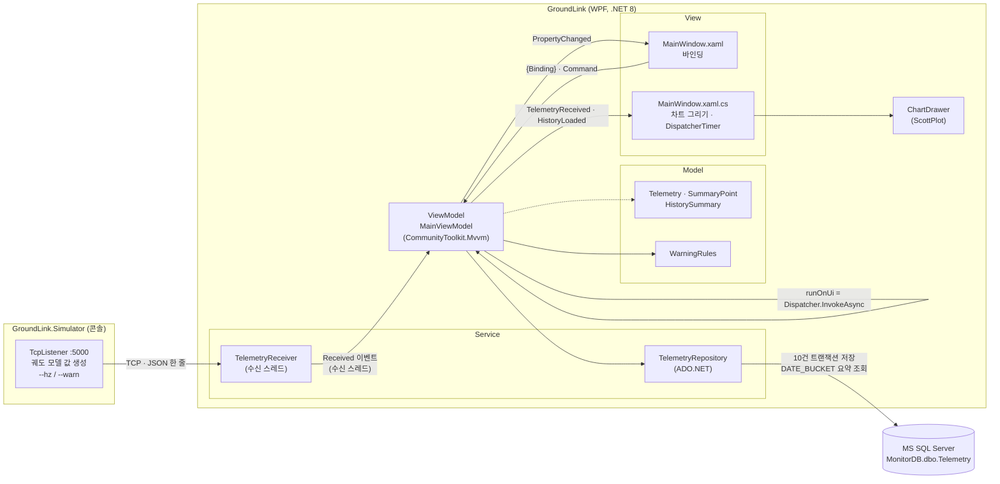

# 05. 이력서·포트폴리오 초안

> 원칙: 측정하지 않은 수치는 쓰지 않았다. 각 문장 끝 괄호는 근거(이력서에 넣을 때는 지울 것).
> **[커밋 전]** 코드가 근거인 문장은 지원 전에 커밋·푸시해서 GitHub에서 보이게 해야 한다.
> 결정·구현 중 AI 도움을 받은 부분은 `04-troubleshooting.md`의 "본인 판단 여부"를 채운 뒤, 직접 설명할 수 있는 것만 남길 것.

## 1. 이력서 프로젝트 블록

**GroundLink — 위성 텔레메트리 실시간 수신·저장·조회 데스크톱 앱 (개인 프로젝트)**

- **한 줄 소개**: 위성 시뮬레이터가 TCP로 보내는 배터리 데이터를 실시간으로 받아 경고를 판정하고, MS SQL에 저장한 기록을 기간별로 요약해 보여주는 C# WPF 앱과 C# 콘솔 시뮬레이터
- **기간·인원**: 2026.11.09 ~ 진행 중 / 1명 (v2 첫 커밋 `96573f8` ~ 마지막 커밋 `28a7fa3` 2026.11.12, 커밋 14개)
- **기술 스택**: C#, .NET 8, WPF, MVVM(CommunityToolkit.Mvvm 8.4.2), MS SQL Server 2022(ADO.NET, Microsoft.Data.SqlClient 7.1.1), ScottPlot 5, TCP 소켓, System.Text.Json, xUnit, Git

**불릿**

1. **[대용량 시계열 요약 조회]** 1초 단위 1주일 데이터(604,800줄)를 그대로 그릴 수 없고 30분 단위 요약은 궤도 주기(94.5분)와 맞물려 진동만 보이는 문제 → SQL `DATE_BUCKET`으로 1일은 5분 평균·최소·최대, 1주일은 궤도 주기 기준점으로 잘라 **바퀴 단위 최고·최저**로 요약하고, 데이터가 빈 시간은 선을 끊어 그리도록 판단 → 1주일 차트 점 수를 바퀴 수(약 106개, 168시간 ÷ 5,669초 계산값)로 제한
   (`DB/02_seed_week.sql:44`, `TelemetryRepository.cs:94-166` [커밋 전 포함], `ChartDrawer.cs:194-211` [커밋 전])
2. **[수신 데이터 저장 신뢰성]** 실시간 수신 데이터를 건마다 저장하면 DB 왕복이 수신 건수만큼 생기고, 묶음 저장은 중복 1건에 전체가 롤백될 수 있는 문제 → 10건을 한 연결·한 트랜잭션으로 저장, 연결이 끊길 때 남은 건 저장, (위성, 시각) 고유 인덱스 + `IGNORE_DUP_KEY`로 중복만 건너뛰도록 설계 → 12건 수신 후 끊었을 때 12줄(10건 묶음 + 2건) 저장 확인
   (`TelemetryRepository.cs:30-63`, `DB/04_unique_time.sql`, 커밋 `685f099`·`28a7fa3`, `DOCS/test-log.md:169`)
3. **[C# 콘솔 시뮬레이터]** 실제 위성 없이 실시간 수신·경고·고속 수신을 검증해야 하는 상황 → 실측 자료(GOMX-4 궤도 주기·그늘 비율·온도 진폭) 기반 궤도 모델로 값을 만드는 TCP 서버 콘솔 앱을 만들고, 전송 속도(`--hz N`)·경고 값(`--warn`) 옵션을 추가, `Thread.Sleep` 해상도(약 15.6 ms) 때문에 고속 전송이 안 되는 문제를 예정 시각 기반 몰아 보내기로 처리 → 1건/초 전송·끊김 후 재대기 테스트 통과
   (`GroundLink.Simulator/Program.cs:22-43, 80-124` [옵션은 커밋 전], 커밋 `46c7be6`·`ae6ab01`, `test-log.md:95-107`)

**[개발 중] 실시간 수신 스레드·UI 갱신**: 별도 수신 스레드 + `Dispatcher`로 화면 갱신, 3초 자동 재접속, 0.1초 단위 화면 갱신 묶기·성능 측정 표시까지 구현. 현재 `async/await`·`CancellationToken` 기반으로 수신 취소·비동기 DB 조회를 다시 구현하며 학습 중.
(`TelemetryReceiver.cs:46-115`, `MainViewModel.cs:218-285`, `03-threading.md`)

> 이 공고처럼 **Console Application 경험**을 보는 곳이면 불릿 3을 맨 위로 올린다.

## 2. 기능별 면접 질문과 알아야 할 개념

| 기능 | 받을 질문 | 답하려면 알아야 할 개념 |
| --- | --- | --- |
| 요약 조회 (`DATE_BUCKET`) | 60만 줄을 어떻게 화면에 그렸나? 왜 DB에서 요약했나? | `GROUP BY`, 집계 함수, `DATE_BUCKET`(origin 인자), 커버링 인덱스(`INCLUDE`), 네트워크로 옮기는 데이터 양 |
| 궤도 단위 요약 | 왜 1주일만 다르게 그렸나? | 에일리어싱(샘플링 주기와 신호 주기), 차트가 답해야 할 질문 정하기 |
| 빈 시간 선 끊기 | 끊는 기준 1.5배는 왜? | 구간 크기 추정(가장 짧은 간격), 시각화 왜곡 |
| 묶음 저장 | 왜 10건인가? 트랜잭션을 왜 썼나? 실패하면? | 트랜잭션·롤백, 파라미터 재사용, 데이터 유실 범위와 저장 주기의 trade-off, `SqlBulkCopy`와 차이 |
| 고유 인덱스 `IGNORE_DUP_KEY` | 중복을 에러로 안 내고 버리면 위험하지 않나? | 고유 인덱스, 무결성, 조용한 유실(시각 1초 단위 문제 → `DATETIME2(3)`) |
| 시뮬레이터 | TCP에서 메시지 경계는 어떻게 나눴나? 클라이언트 여러 개면? | TCP 스트림(경계 없음) → 줄바꿈 구분, `TcpListener`/`AcceptTcpClient` 블로킹, 1클라이언트 구조의 한계 |
| 고속 전송 | `Thread.Sleep(10)`이 왜 10 ms가 아닌가? | OS 타이머 해상도, `Stopwatch`, 드리프트 없는 주기 계산 |
| 경고 판정 | 기준값 근거는? 경계값은 어떻게 테스트했나? | 순수 함수, `[Theory]`/`[InlineData]` 경계값 테스트 (`WarningRulesTests.cs`) |
| MVVM | 코드 비하인드에 뭐가 남았고 왜? ViewModel이 WPF를 모르게 한 이유는? | `INotifyPropertyChanged`, 바인딩, `ICommand`/`CanExecute`, 소스 생성기, ScottPlot이 바인딩 미지원인 점, 테스트 가능성 |
| [개발 중] 수신 스레드 | UI 스레드에서 소켓을 받으면? 왜 `InvokeAsync`? 수신을 멈추려면? | UI 스레드 모델, 블로킹 I/O, Dispatcher, `CancellationToken` (`03-threading.md`) |
| [개발 중] 갱신 묶기 | 왜 0.1초? 효과를 어떻게 증명하나? | 생산자-소비자 큐(`ConcurrentQueue`), `DispatcherTimer`, 측정 지표(그리기 시간·지연) — 측정 전이라 수치 질문엔 "측정 예정"이라고 답할 것 |

## 3. 포트폴리오 페이지 구성안

| 순서 | 페이지 | 들어갈 내용 | 자료 |
| --- | --- | --- | --- |
| 1 | 표지 | 프로젝트명, 한 줄 소개, 기간·인원, 기술 스택 아이콘, GitHub 링크 | `01-overview.md` 1~2절 |
| 2 | 개요 | 무엇을 하는 앱인가(위성 → 시뮬레이터 → 앱 → DB 흐름), 만든 이유, 기능 목록 6~8개 | `01-overview.md`, `02-features.md` 완성 항목 |
| 3 | 주요 화면 | 메인 화면(수신 중), 재접속 상태 3장(접속 중·끊김·복귀), 과거 기록(1일/1주일), 시뮬레이터 콘솔 | `screenshots/`, `06-screenshots.md` 캡처 목록 |
| 4 | 아키텍처 | 아래 Mermaid 다이어그램, 스레드 흐름(수신 스레드 → 큐 → UI 스레드), DB 테이블·인덱스 | 다이어그램, `03-threading.md` 2절, `DB/01·04·05` |
| 5 | 트러블슈팅 | 사례 2~3개 (추천: 3 궤도 단위 요약, 7·8 중복/유실, 6 Sleep 정밀도), 각 "문제 → 원인 → 해결 → 결과" + 전후 화면 또는 코드 | `04-troubleshooting.md` |
| (선택) | 테스트·문서화 | 수동 테스트 기록표(T-ID), 단위 테스트 목록, 요구사항 정의서 | `DOCS/test-log.md`, `DOCS/requirements.md` |

## 4. 아키텍처 다이어그램 (Mermaid)

> 다이어그램은 현재 작업 폴더 구조 기준이다 (`ViewModels/`는 [커밋 전]). 근거: `MainWindow.xaml.cs:54-65`, `MainViewModel.cs:56, 165-176`, `TelemetryReceiver.cs:31-37`.
